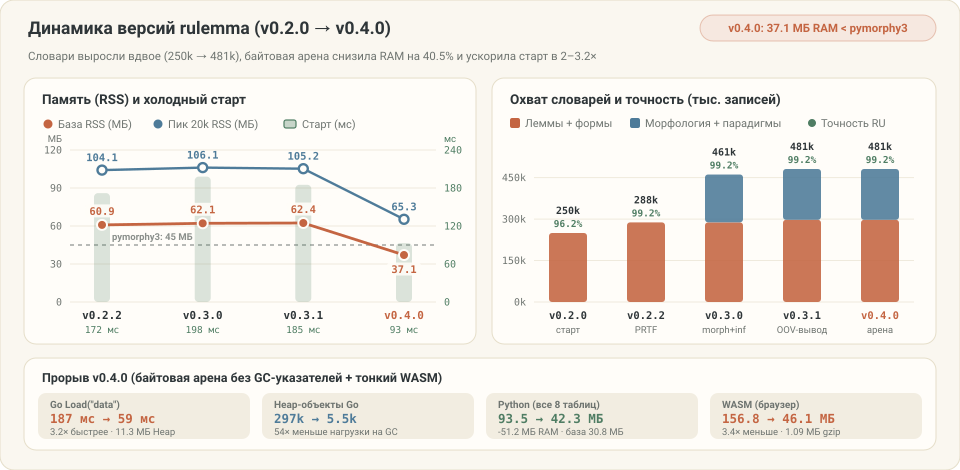
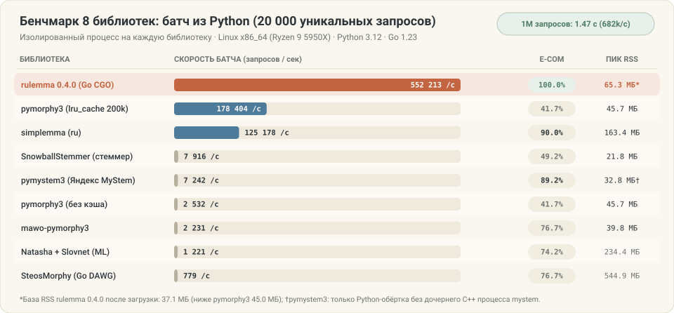
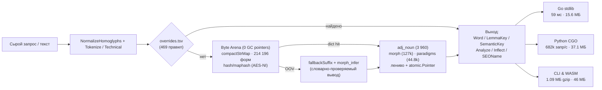

<div align="center">

<a href="https://rulemma.ru/">
  
</a>

<h1>rulemma</h1>

<p>Словарный лемматизатор, компактный морфоанализатор и движок склонения русского языка<br />
Go (stdlib) · Python (ctypes, 0 зависимостей) · CLI · WebAssembly</p>

<p>
  <a href="https://github.com/DimaKorshikov/rulemma/actions/workflows/ci.yml"></a>
  <a href="https://rulemma.ru/"></a>
  <a href="https://github.com/DimaKorshikov/rulemma/releases"></a>
  <a href="https://go.dev/"></a>
  <a href="https://www.python.org/"></a>
  <a href="LICENSE"></a>
</p>

<p>
  <a href="https://rulemma.ru/">Сайт</a> ·
  <a href="https://rulemma.ru/tools/">Попробовать в браузере (WASM)</a> ·
  <a href="#динамика-версий">Динамика версий</a> ·
  <a href="#сравнение-с-конкурентами-и-бенчмарк">Бенчмарк</a> ·
  <a href="#быстрый-старт">Быстрый старт</a> ·
  <a href="#словари-и-настройка-под-свой-домен">Словари</a> ·
  <a href="CHANGELOG.md">Changelog</a>
</p>

<p><sub>37.1 МБ RSS в Python (меньше pymorphy3) · 682 309 запр/с (1 млн за 1.47 с) · 59 мс старт в Go · 1.09 МБ WASM</sub></p>

</div>

---

## Зачем появилась эта библиотека

Стандартные морфологические анализаторы русского языка создавались под художественную прозу и новости. На миллионах коротких поисковых запросов и карточек каталога они системно ошибаются на брендах, причастиях, технических характеристиках и упираются в GIL.

| Задача | Обычный анализатор (OpenCorpora без очистки) | rulemma 0.4.0 |
|---|---|---|
| Бренды и единицы измерения | спрей → спреть, худи → худить, сяоми → сяомь, см → смотреть | спрей, худи, сяоми, см, кофемашина |
| Причастия в карточках | оцинкованные → оцинковать, встраиваемые → встраивать | оцинкованный, встраиваемый (3 755 причастий) |
| Неявные дубли запросов | зимние кроссовки ≠ кроссовки на зиму | Одинаковый `semantic_key`: зима кроссовок |
| Характеристики и отрицания | 2,6 л.с. == 6,2 л.с., 100×100 см == 100 см, без сахара == с сахаром | Разные ключи в `profile="technical"` + сохранение «без» |
| Склонение товарных фраз | Склоняет бренды, артикулы и предложные хвосты | стиральная машина LG F2V5 → стиральную машину LG F2V5 |
| Скорость и память | 2 500 запр/с без кэша, GIL, сотни МБ у DAWG/нейросетей | 552 213–682 309 запр/с в горутинах Go, 37.1 МБ RSS |

Внутри ядра — очищенный словарь на 214 196 словоформ в байтовой арене без GC-указателей, словарно-проверяемый OOV-fallback без обрубков, таблица из 3 960 пар прилагательное → существительное, 74 098 форм согласования, приоритетный `data/overrides.tsv` (469 правил) и лениво подгружаемые таблицы морфологии (127 163 словоформ, 11 909 омонимов, парадигмальный OOV-вывод) и склонения (44 819 записей: 347 парадигм на 44 472 лемм).

---

<a id="динамика-версий"></a>

## Динамика версий (v0.2.0 → v0.4.0)

За пять релизов объём словарных и грамматических таблиц вырос почти вдвое (250k → 481k записей), точность доведена до 99.2% / 100.0% / 100.0%, а переход на байтовую арену без GC-указателей в v0.4.0 снизил базовый RSS ниже pymorphy3 (62.4 → 37.1 МБ) и ускорил загрузку в 2–3.2 раза.

<p align="center">
  <picture>
    <source media="(prefers-color-scheme: dark)" srcset="assets/version-evolution-dark.svg" />
    <source media="(prefers-color-scheme: light)" srcset="assets/version-evolution-light.svg" />
    
  </picture>
</p>

| Версия | Записей | Старт (Py / Go) | База RSS | Что появилось |
|---|---:|---:|---:|---|
| v0.2.0 | 250k | 209 мс / — | — | Ядро Go + Python CGO, `lemma_key`, `semantic_key`, `BuildSEOName` |
| v0.2.2 | 288k | 172 мс / — | 60.9 МБ | 3 755 причастий, защита 2–3-букв. слов, `embedded`, ABI v1 |
| v0.3.0 | 461k | 198 мс / — | 62.1 МБ | `profile="technical"`, омоглифы, `Analyze`, `InflectPhrase`, fork-защита |
| v0.3.1 | 481k | 185 мс / 187 мс | 62.4 МБ | 3-ступенчатый OOV-вывод, чистка 2 694 артефактов и 50 пар `adj_noun` |
| **v0.4.0** | 481k | 93 мс / 59 мс | 37.1 МБ | Байтовая арена без GC (5.5k объектов вместо 297k), `LoadMemory`, WASM 1.09 МБ |

<details>
<summary>Подробное сравнение Go, Python и WebAssembly в v0.4.0 (до и после)</summary>

<br />

| Среда и метрика | До (v0.3.1 / v0.3.0 WASM) | После (v0.4.0) | Изменение |
|---|---:|---:|---:|
| Go `Load("data")`: время / HeapAlloc / HeapObjects | 187.2 мс / 37.1 МБ / 297 491 | 59.0 мс / 11.3 МБ / 5 522 | 3.2× быстрее, 54× меньше GC |
| Go RSS: `Load("data")` / `Preload()` (все 8 таблиц) | 42.0 МБ / 79.0 МБ | 15.6 МБ / 29.2 МБ | −26.4 МБ / −49.8 МБ |
| Python `RuLemma()`: старт / RSS (база → все 8) | 181 мс / 56.4 → 93.5 МБ | 55.5 мс / 30.8 → 42.3 МБ | 3.3× быстрее, −51.2 МБ |
| WASM `full` (`wasm_embed`): старт / память | 881.4 мс / 156.8 МБ | 317.2 мс / 80.7 МБ | 2.8× быстрее, −76.1 МБ |
| WASM `core` (`rulemma_core`): gzip / старт / память | 3.69 МБ / 881.4 мс / 156.8 МБ | 2.29 МБ / 260.2 мс / 39.3 МБ | −38% вес, 4× меньше RAM |
| WASM `thin` (`LoadMemory`): gzip / старт / память | 3.69 МБ / 881.4 мс / 156.8 МБ | 1.09 МБ / 258.5 мс / 46.1 МБ | 3.4× быстрее, −110.7 МБ |

</details>

---

<a id="сравнение-с-конкурентами-и-бенчмарк"></a>

## Сравнение с конкурентами и бенчмарк

Сравнение `rulemma 0.4.0` с семью популярными библиотеками русского NLP выполнено одним воспроизводимым скриптом [benchmarks/compare_models.py](benchmarks/compare_models.py). Каждая библиотека запускалась в отдельном изолированном процессе для честного замера пикового RSS (20 000 уникальных 7-словных запросов, 751 уникальных токенов, Linux x86_64, AMD Ryzen 9 5950X, Python 3.12.3, Go 1.23).

<p align="center">
  <picture>
    <source media="(prefers-color-scheme: dark)" srcset="assets/benchmark-dark.svg" />
    <source media="(prefers-color-scheme: light)" srcset="assets/benchmark-light.svg" />
    
  </picture>
</p>

| Библиотека | Общий RU | E-Com | Дедуп F1 | Пик RSS | 1 запрос | Батч 20k |
|---|---:|---:|---:|---:|---:|---:|
| **rulemma 0.4.0** (Go CGO, MIT) | 99.2% | 100.0% | 100.0% (FP=0) | 65.3 МБ* | 132.3 мкс | 552 213 запр/с |
| [pymorphy3](https://github.com/no-plagiarism/pymorphy3) (без кэша) | 94.7% | 41.7% | 18.2% (FP=0) | 45.7 МБ | 394.8 мкс | 2 532 запр/с |
| [pymorphy3](https://github.com/no-plagiarism/pymorphy3) (`lru_cache` 200k) | 94.7% | 41.7% | 18.2% (FP=0) | 45.7 МБ | 5.6 мкс | 178 404 запр/с |
| [mawo-pymorphy3](https://pypi.org/project/mawo-pymorphy3/) 1.0.4 | 81.2% | 76.7% | 14.0% (FP=0) | 39.8 МБ | 452.0 мкс | 2 231 запр/с |
| [SteosMorphy](https://github.com/SteosOfficial/SteosMorphy-py) 1.1.1 | 84.2% | 76.7% | 18.2% (FP=0) | 544.9 МБ | 3 165.9 мкс | 779 запр/с |
| [Natasha](https://github.com/natasha/natasha) (Slovnet) | 95.5% | 74.2% | 13.6% (FP=1) | 234.4 МБ | 818.5 мкс | 1 221 запр/с |
| [simplemma](https://github.com/adbar/simplemma) (ru) | 93.2% | 90.0% | 14.0% (FP=0) | 163.4 МБ | 8.0 мкс | 125 178 запр/с |
| [pymystem3](https://github.com/nlpub/pymystem3) (MyStem) | 92.5% | 89.2% | 22.2% (FP=0) | 32.8 МБ† | 137.2 мкс | 7 242 запр/с |
| [SnowballStemmer](https://github.com/snowballstem/snowball) (ru) | 16.5%‡ | 49.2%‡ | 29.2% (FP=1) | 21.8 МБ | 126.3 мкс | 7 916 запр/с |

<sub>*У rulemma 0.4.0 сразу после загрузки базовых словарей RSS процесса составляет 37.1 МБ (ниже pymorphy3 с его 45.0 МБ; в чистом процессе Python 30.8 МБ, в чистом Go 15.6 МБ RSS / 11.3 МБ HeapAlloc). Пик 65.3 МБ возникает во время параллельного батча из 20 000 строк. У SteosMorphy словарь на диске занимает 445 МБ против 2.6 МБ у rulemma.<br />†В pymystem3 бинарник mystem работает в дочернем процессе, поэтому RUSAGE_SELF отражает только Python-обёртку.<br />‡SnowballStemmer возвращает усечённые основы, а не словарные леммы.</sub>

На масштабировании из Python (уникальные 7-словные запросы) rulemma 0.4.0 обрабатывает **1 000 000 запросов за 1.47–1.60 с**: 623 888 запр/с для `lemmatize_batch` и 682 309 запр/с для `semantic_keys` (однопроходный `lemmatize_all` возвращает все 3 колонки в 1.2–1.4 раза быстрее трёх раздельных вызовов). В чистом Go один вызов `LemmaKey` занимает ~3.6 мкс (664 Б, 20 аллокаций), а загрузка `Load("data")` — ~59 мс. Полные сырые замеры: [benchmarks/results.json](benchmarks/results.json) и [benchmarks/RESULTS.md](benchmarks/RESULTS.md).

<details>
<summary>Примеры ответов: rulemma против pymorphy3, MyStem и simplemma</summary>

<br />

| Слово | rulemma 0.4.0 | pymorphy3 | MyStem | simplemma |
|---|---|---|---|---|
| спрей | спрей | спреть | спрей | спрей |
| кофемашина | кофемашина | кофемашин | кофемашина | кофемашина |
| кружка | кружка | кружка | кружка | кружок |
| худи | худи | худить | худить | худи |
| сяоми | сяоми | сяомь | сяомить | сяоми |
| см | см | смотреть | см | сантиметр |
| мелки | мелок | мелок | мелкий | мелкий |
| оцинкованные | оцинкованный | оцинковать | оцинковывать | оцинкованный |
| роботов-пылесосов | робот-пылесос | робот-пылесос | робот-пылесос | роботов-пылесосов |
| цветов (без контекста) | цвет | цвет | цветок | цветок |

</details>

## Открытые оговорки по методике замера

1. **Авторство тестовых наборов.** Все три файла ([benchmarks/gold_general_ru.tsv](benchmarks/gold_general_ru.tsv), [benchmarks/gold_ecommerce_ru.tsv](benchmarks/gold_ecommerce_ru.tsv), [benchmarks/gold_dedup_pairs.tsv](benchmarks/gold_dedup_pairs.tsv)) составлены авторами rulemma. В v0.2.1 были закрыты 5 реальных промахов, найденных при выпуске v0.2.0 (отпариватели, дочерей, воробьев, автодорог, большие), и зафиксированы в [CHANGELOG.md](CHANGELOG.md) и золотых тестах [tests/golden/](tests/golden/). Единственное расхождение на `gold_general_ru.tsv` (132/133, 99.2%) — честный бесконтекстный омоним цветов → цвет (в тесте ожидается цветок).
2. **Дедупликация F1 у конкурентов (13.6%–22.2%).** Из 40 положительных пар в `gold_dedup_pairs.tsv` 35 проверяют склейку относительного прилагательного с существительным (зимние кроссовки ↔ кроссовки на зиму, кожаный ремень ↔ ремень из кожи) и 5 — обычное словоизменение. Без `adj -> noun` метод `lemma_key` набирает те же 22.2%, а `semantic_key` — 100.0% (FP=0) и не склеивает 15 пар-ловушек (умные часы ≠ часы ум, мороженая рыба ≠ мороженое рыба, соленые огурцы ≠ соль огурцы).
3. **Одиночный вызов из Python.** При вызове по одному запросу в цикле pymorphy3 с `lru_cache` (5.6 мкс) и simplemma (8.0 мкс) быстрее rulemma (132.3 мкс) из-за перехода `ctypes → CGO`. Преимущество Go раскрывается на батчах (`lemmatize_all`, `lemmatize_batch`, `semantic_keys`, `keys_batch`), в CLI и при вызове из Go.
4. **Кэш pymorphy3.** В тесте на 20 000 запросов словарь ограничен 751 уникальными токенами, поэтому `lru_cache(200_000)` показывает 178 404 запр/с. На реальных логах с миллионами уникальных артикулов и опечаток скорость падает в сторону режима без кэша (2 532 запр/с).

---

<a id="быстрый-старт"></a>

## Быстрый старт

### Python (нативный CGO через `ctypes`, 0 зависимостей)

Для сборки разделяемой библиотеки `librulemma.so` (или `.dylib` на macOS) нужны Go 1.21+ и компилятор C (`gcc` или `clang`). В рантайме Python сторонние пакеты не требуются.

```bash
git clone https://github.com/DimaKorshikov/rulemma.git
cd rulemma
make build            # собирает bin/rulemma и python/rulemma/librulemma.so
pip install .
```

```python
from rulemma import RuLemma, normalize_homoglyphs, normalize_phrase, preposition

print(normalize_phrase("  Чёрная кофемашина, 35 см! "))  # черная кофемашина 35 см
print(normalize_homoglyphs("Кабель 5cм intеl рrо"))      # Кабель 5см intel pro

with RuLemma(min_version="0.4.0") as lem:
    print(lem.backend, lem.library_version, lem.abi_version)  # native 0.4.0 1
    print(lem.word("спрей"), lem.word("см"))                  # спрей см
    print(lem.lookup_word("судебного"))                       # ('судебный', 'rule')

    # Смысловой ключ и технический профиль (дроби, размеры, слэши, отрицания)
    a = lem.semantic_key("зимние кроссовки найк")
    b = lem.semantic_key("кроссовки на зиму найк")
    assert a == b == "зима кроссовок найк"
    print(lem.semantic_key("зимние ботинки б/у", profile="technical"))
    # "б/у ботинок зима"

    # Морфоанализ (с OOV-выводом) и склонение коротких товарных фраз
    assert lem.prep_governs("с", "дипломом") is True
    print(lem.inflect_phrase("стиральная машина LG F2V5", "accs"))
    # ('стиральную машину LG F2V5', True)
    print(lem.agree_number(21, "товар"), preposition("с", "скидкой"))
    # 21 товар со

    # Однопроходный параллельный батч в горутинах Go (без GIL)
    queries = ["зимние кроссовки найк", "кроссовки на зиму найк"]
    print(lem.lemmatize_all(queries, profile="technical"))
```

Для обработки тысяч и миллионов строк передавайте списки в `lemmatize_all`, `lemmatize_batch`, `lemma_keys`, `semantic_keys` или `keys_batch` — переход `ctypes → CGO` выполняется один раз на весь батч, а работа идёт параллельно на всех ядрах CPU.

> [!IMPORTANT]
> **Многопроцессность и `os.fork()`:** рантайм Go запускает фоновые потоки при загрузке `librulemma.so`. В Python используйте `multiprocessing.get_context("spawn")` либо создавайте `RuLemma()` только после `fork()`. При вызове в форкнутом потомке после загрузки библиотеки в родителе поднимается `RuntimeError` вместо зависания.

<details>
<summary>Расширенные возможности Python API (связки предлогов, омонимы, сборка SEO-названий)</summary>

<br />

```python
from rulemma import RuLemma

with RuLemma(min_version="0.4.0") as lem:
    # Связки предлогов, защита главного слова и дроби в техпрофиле
    k1 = lem.key("кофе без сахара с молоком", preserve_prep_bindings=True)
    k2 = lem.key("кофе с сахаром без молока", preserve_prep_bindings=True)
    assert k1 != k2

    k3 = lem.key("пластиковые окна", bind_purpose_prep=True)
    k4 = lem.key("пластик для окон", bind_purpose_prep=True)
    assert k3 != k4

    k5 = lem.key("зеркальный пластик", keep_words={"пластик"})
    k6 = lem.key("пластиковое зеркало", keep_words={"пластик"})
    assert k5 != k6

    # Все словарные кандидаты для омонима и защита предлога от цифр ("витамин С 1000")
    print(lem.analyze("пил")["candidates"])
    assert lem.prep_governs("с", "1000") is False

    # Согласование прилагательных и сборка SEO-названия с лимитом длины
    print(lem.agree_adjective("оцинкованные", "Ведро"))  # ('оцинкованное', True)
    print(lem.build_seo_name("Сумка кожаная", "Сумка", ["кожаный", "синие"], 100))
    # ('Сумка кожаная, синяя', 1, 1)
```

</details>

<details>
<summary>Go (go get, embedded 2.6 МБ / -tags rulemma_core 1.2 МБ, LoadMemory)</summary>

<br />

Модуль не имеет внешних зависимостей; потокобезопасность проверена под `go test -race ./...`. Доступны три режима загрузки: с диска (`rulemma.Load("data")`), встраивание одной строкой через `rulemma/embedded` (2.6 МБ все 8 таблиц или 1.2 МБ ядра с `-tags rulemma_core`) и загрузка из памяти (`rulemma.LoadMemory` + отложенная `LoadTable`).

```bash
go get github.com/DimaKorshikov/rulemma
```

```go
package main

import (
    "fmt"
    "log"

    "github.com/DimaKorshikov/rulemma"
    "github.com/DimaKorshikov/rulemma/embedded"
)

func main() {
    lem, err := embedded.Load() // или rulemma.Load("data")
    if err != nil {
        log.Fatal(err)
    }

    fmt.Println(rulemma.NormalizePhrase("Чёрная, 35 см!", false)) // черная 35 см
    fmt.Println(lem.Word("отпариватели"))                         // отпариватель
    fmt.Println(lem.SemanticKey("зимние кроссовки найк"))         // зима кроссовок найк

    tech := rulemma.KeyOptions{
        Semantic:             true,
        Profile:              "technical",
        PreservePrepBindings: true,
    }
    fmt.Println(lem.KeyWithOptions("кофе без сахара с молоком", tech))
    // без_сахар кофе молоко

    fmt.Println(lem.PrepGoverns("с", "цинком")) // true
    inf, _ := lem.InflectPhrase("стиральная машина LG F2V5", "accs", "")
    fmt.Println(inf, "|", lem.AgreeNumber(21, "товар"))
    // стиральную машину LG F2V5 | 21 товар
}
```

</details>

<details>
<summary>CLI (bin/rulemma — потоковая обработка TSV и stdin в горутинах)</summary>

<br />

```bash
make build-cli

# Версия движка/ABI и статистика загруженных словарей + manifest.json
./bin/rulemma version
./bin/rulemma info --data data

# Поток через stdin (режимы: text | key | semkey | both | all | norm)
printf "зимние ботинки б/у\nкофе без сахара с молоком\n" \
  | ./bin/rulemma lemmatize --mode semkey --profile technical --bind-preps

# Морфологический разбор и склонение
./bin/rulemma analyze пил
./bin/rulemma inflect --case accs стиральная машина LG F2V5

# Потоковый TSV (O(workers) RAM: ~58 МБ на --workers 4, до 1.6M строк/с на 32)
./bin/rulemma tsv --in queries.tsv --out out.tsv --col 0 --mode all --workers 4
```

</details>

<details>
<summary>WebAssembly (make build-wasm — 3 профиля: thin 1.09 МБ / core 2.29 МБ / full 3.63 МБ gzip)</summary>

<br />

Референсный модуль [cmd/rulemma-wasm/](cmd/rulemma-wasm/) собирается командой `make build-wasm` в три профиля:

```bash
make build-wasm
# bin/wasm/rulemma-thin.wasm  raw= 3.98 MB  gzip-9= 1.09 MB  (LoadMemory/LoadTable)
# bin/wasm/rulemma-core.wasm  raw= 5.25 MB  gzip-9= 2.29 MB  (wasm_embed,rulemma_core)
# bin/wasm/rulemma-full.wasm  raw= 6.59 MB  gzip-9= 3.63 MB  (wasm_embed)
```

В режиме `thin` браузер компилирует `rulemma-thin.wasm` (1.09 МБ gzip) параллельно с загрузкой базовых таблиц (`lemmas.tsv.gz` + `adj_noun.tsv.gz` + `overrides.tsv` = 1.19 МБ), а `paradigms.tsv.gz` (214 КБ) или `morph.tsv.gz` (559 КБ) докачивает по клику через `rulemmaLoadTable` за ~33 мс (линейная память WASM — 46.1 МБ).

</details>

---

<a id="архитектура-конвейера"></a>

## Архитектура конвейера



---

## Когда лучше взять Natasha, MyStem, pymorphy3 или simplemma

`rulemma` — бесконтекстный словарный движок под короткие поисковые запросы, товарные каталоги, SEO-кластеризацию и пакетные задачи на миллионы строк.

- Берите [Natasha](https://github.com/natasha/natasha) или [Яндекс MyStem](https://yandex.ru/dev/mystem/), если разбираете связные предложения, новости и отзывы, где форма зависит от синтаксиса («они стали работать» vs «термос из нержавеющей стали»), либо нужны NER и синтаксический разбор.
- Берите [pymorphy3](https://github.com/no-plagiarism/pymorphy3), если нужны вероятностные предсказатели редких несловарных OOV-глаголов или полный набор редких граммем OpenCorpora (вид, залог, наклонение, лицо). Для существительных, прилагательных, причастий, предложного управления и омонимов в `rulemma` уже встроены `analyze`, `prep_governs`, `inflect` и `inflect_phrase`.
- Берите [simplemma](https://github.com/adbar/simplemma), если проект мультиязычный (40+ языков) и нужен чистый Python без компилятора Go.
- Берите **rulemma**, если обрабатываете русскоязычные поисковые запросы, каталоги и теги, хотите убрать ошибки OpenCorpora на брендах, единицах измерения и причастиях, беречь технические характеристики, склеивать пары прилагательное ↔ существительное и укладываться в ~37 МБ RSS при сотнях тысяч запросов в секунду под MIT-лицензией.

---

<a id="словари-и-настройка-под-свой-домен"></a>

## Словари и настройка под свой домен

Все данные лежат в папке `data/` в сжатых TSV-файлах общим весом 2.6 МБ с манифестом версий и контрольных сумм SHA-256 [data/manifest.json](data/manifest.json).

<details open>
<summary>Состав 8 таблиц словаря (dict_version: 2026.11.5, schema_version: 1)</summary>

<br />

- `data/lemmas.tsv.gz` — 214 196 очищенных русских и товарных словоформ (нормализация 3 755 причастий, ударных `-ой` прилагательных, защита 2–3-буквенных слов и дефисных городов РФ).
- `data/adj_forms.tsv.gz` — 74 098 словоформ прилагательных и причастий для согласования по роду и числу (индекс по 18 776 основам в 4-слотовой арене).
- `data/types.tsv.gz` — 4 669 записей рода и числа для товарных типов (с поддержкой мн. ч. и составных названий в `TypeGram`).
- `data/adj_noun.tsv.gz` — 3 960 проверенных относительных пар прилагательное → существительное (`tools/build_adj_noun.py`) с защитой от смыслового дрейфа.
- `data/morph.tsv.gz` — 127 163 словоформ с 32-битной маской грамматических признаков (POS, род, число, падежи, одушевлённость, `Pltm`/`Sgtm`/`Fixd`; загружается лениво).
- `data/alt_lemmas.tsv.gz` — 11 909 омонимичных словоформ со всеми словарными разборами (загружается лениво).
- `data/paradigms.tsv.gz` — 44 819 записей (347 суффиксных парадигм для 44 472 существительных, прилагательных и причастий; загружается лениво).
- `data/overrides.tsv` — 469 базовых ручных правок с наивысшим приоритетом.
- `data/manifest.json` — схема `schema_version: 1`, версия словаря, счётчики записей и SHA-256 хеши всех файлов.

</details>

Свой файл переопределений подключается без пересборки словарей через `--overrides custom.tsv` в CLI, `RuLemma(overrides="custom.tsv")` в Python или `Options{ExtraOverridesPath: "custom.tsv"}` в Go (см. [examples/10_ecommerce_overrides/](examples/10_ecommerce_overrides/)):

```tsv
# слово<TAB>лемма
ушм	болгарка
квадрокоптеры	дрон
```

---

## Примеры использования (`examples/01..13`)

В папке [examples/](examples/README.md) собраны 13 проверяемых примеров (Python, Go и CLI), которые прогоняются в CI на каждый коммит: базовая лемматизация, сравнение со стеммингом, пакетная обработка 100 000 строк и TSV, миграция с pymorphy3, Go-горутины с `embedded.Load()`, препроцессинг, кастомные стоп-слова, частотный анализ, дедупликация запросов, кастомные `overrides.tsv`, сборка SEO-названий, TF-IDF и возможности v0.3–v0.4.

<details>
<summary>Структура репозитория</summary>

```text
rulemma/
├── version.go         # Version (0.4.0), ABIVersion (1), DictSchemaVersion (1)
├── arena.go           # Байтовые арены без GC-указателей + hash/maphash
├── memfs.go           # Потокобезопасная in-memory fs.FS (LoadMemory / LoadTable)
├── dict.go            # Потоковый zero-alloc загрузчик .tsv.gz и manifest.json
├── lemmatizer.go      # NormalizePhrase, Word, LookupWord, LemmaKey, SemanticKey, SEOName
├── technical.go       # NormalizeHomoglyphs, TokenizeTechnical, KeyWithOptions
├── morph.go           # Ленивый морфоанализ: Analyze, WordCandidates, PrepGoverns
├── morph_infer.go     # Вывод морфологии для OOV-словоформ через paradigms.tsv.gz
├── inflect.go         # Склонение: Inflect, InflectPhrase, AgreeNumber, Preposition
├── embedded/          # //go:embed (2.6 МБ или 1.2 МБ с -tags rulemma_core)
├── capi/capi.go       # Append-only C-shared библиотека (ABI v1)
├── cmd/rulemma/       # Параллельный CLI (version, info, lemmatize, tsv, analyze)
├── cmd/rulemma-wasm/  # WebAssembly-модуль (thin 1.09 МБ / core 2.29 МБ / full 3.63 МБ)
├── python/rulemma/    # Python-пакет без зависимостей (ctypes + fork-safety)
├── data/              # Компактные словари (.tsv.gz), overrides.tsv, manifest.json
├── assets/            # Акварельная обложка и Light/Dark SVG-графики README
├── examples/          # 13 проверяемых примеров на Python, Go и CLI
├── tools/             # Сборка словарей, manifest и release_check.py
├── benchmarks/        # Золотые наборы (.tsv), сравнение 8 библиотек, render_charts.py
└── tests/             # Python-тесты, тесты примеров и tests/golden/
```

</details>

<details>
<summary>Воспроизведение тестов, WASM, бенчмарков и графиков</summary>

```bash
# Сборка CLI и разделяемой библиотеки, проверка манифеста, Go (-race), Python и examples
make build
make release-check
make test

# Сборка 3 профилей WebAssembly (thin / core / full) в bin/wasm/
make build-wasm

# Сравнение 8 библиотек + масштабирование до 1M + перегенерация SVG-ассетов README
python3 -m venv .venv-bench
.venv-bench/bin/pip install "setuptools<81" pymorphy3 mawo-pymorphy3 steosmorphy \
  natasha pymystem3 simplemma snowballstemmer
.venv-bench/bin/python benchmarks/compare_models.py --scale
make charts
```

</details>

---

## Авторы и лицензия

Авторы: **Коршиков Дмитрий и Gemini**. Официальный сайт проекта: [rulemma.ru](https://rulemma.ru/).

Код распространяется под лицензией MIT, подробности в файле [LICENSE](LICENSE). Словарная основа построена на открытых русских морфологических парадигмах [OpenCorpora](https://opencorpora.org/), очищенных автоматическими лингвистическими правилами (`tools/build_dicts.py`) и ручными переопределениями.
